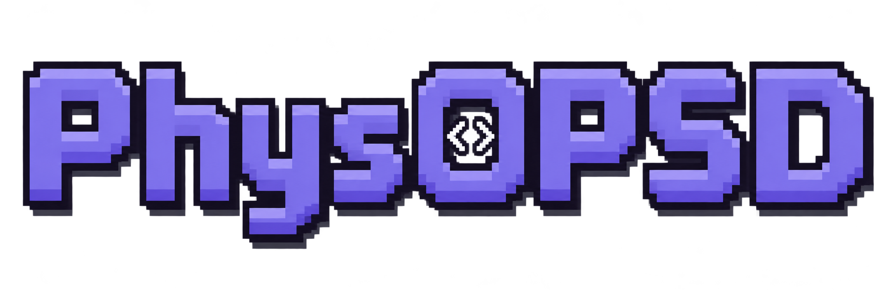
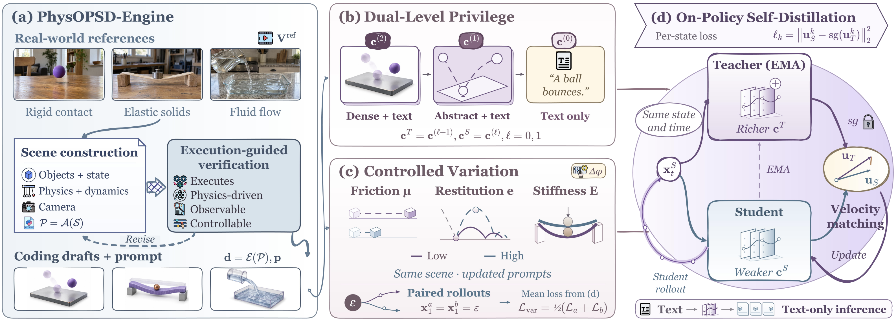

<div align="center">



## Code as Privilege for Physically Plausible Video Generation

Harold Haodong Chen<sup>1,2</sup>, Rui Peng<sup>2</sup>, Lingteng Qiu<sup>2</sup>, Kejie Qiu<sup>2</sup>, Chao Xu<sup>2</sup>, Zilong Dong<sup>2</sup>

<sup>1</sup> HKUST &nbsp; <sup>2</sup> Alibaba Token Hub, Alibaba Group

[Paper](https://arxiv.org/abs/2611.12411) &nbsp; | &nbsp; [Project Page](https://haroldchen19.github.io/PhysOPSD-site/) &nbsp; | &nbsp; [BibTeX](#citation)

</div>

## Release status

**The paper and project page are available. Code release is pending approval.** This repository provides links to the paper and project page, the framework figure, and citation information. Training and inference code will be made available after approval; pretrained weights are not included in this release.

- [x] Paper and project page
- [ ] Training and inference code — pending approval
- [ ] Pretrained model weights

## Overview

**PhysOPSD is a general post-training framework for physically plausible video generation.** It uses executable code as privileged physical context to strengthen a video model's own predictions during on-policy self-distillation. Coding agents supply structured physical supervision, and the resulting capabilities stay in the generator, with **no simulator or physical drafts required at inference**.

<p align="center"></p>

- **Executable physical context.** PhysOPSD-Engine translates reference scenarios into verifiable scene programs and renders physical drafts.
- **Dual-level privilege.** Dense drafts → abstract drafts → text progressively transfer physical information while limiting appearance shortcuts.
- **Controlled physical variation.** Paired worlds vary a physical parameter under shared rollout noise. An EMA self-teacher supervises student-visited states with richer physical context.

Visit the [project page](https://haroldchen19.github.io/PhysOPSD-site/) for video comparisons and case studies, and read the [paper](https://haroldchen19.github.io/PhysOPSD-site/assets/PhysOPSD.pdf) for the method and experiments.

## Citation

If you find this work useful, please cite:

```bibtex
@article{chen2026physopsd,
  title={PhysOPSD: Code as Privilege for Physically Plausible Video Generation},
  author={Chen, Harold Haodong and Peng, Rui and Qiu, Lingteng and Qiu, Kejie and Xu, Chao and Dong, Zilong},
  journal={arXiv preprint arXiv:2611.12411},
  year={2026}
}
}
```

## Contact

Please open a GitHub issue for questions about the paper or release updates.
